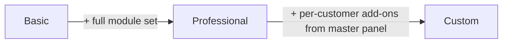

# Introduction

**HostPanel** is Wono's B2B host-facing admin panel. Hosts (coworking/co-living/café operators who join the Wono platform) use it to run their business: organization & workspace setup, HR, sales/CRM, tickets, meeting room bookings, visitor management, finance, and their own public website — all gated by a subscription plan and per-department module access.

## Plans

HostPanel has **3 plans**, defined in `server/config/workspaceModuleCatalog.ts`:

- **Basic** — the default plan every new workspace starts on.
- **Professional** — everything in Basic, plus the full operational module set (Tickets, Meeting Rooms, Calendar, Sales CRM, Administration, etc).
- **Custom** — same default access as Professional, plus whatever extra modules Wono staff individually enable for that workspace from master panel. There's no fixed "Custom" module list — it's Professional's defaults + per-customer add-ons.

### What Basic unlocks by default
Dashboard, Customer Support, standard Visitor Management, Website Builder (+ Leads, Reviews), Nomad Listings, Organization Management (user invites/roles), Access Grants, Analytics.

### What Professional adds on top of Basic
Full Visitor Management (bookings, clients, workspace tours, walk-ins), Tickets, Meeting Room Booking, Calendar, Printouts, Workspace Settings & Management, Department Accesses for **Administration** (tenant companies, bookings, resource management, house keeping) and **Sales** (leads, tenant companies, virtual offices, resource & pricing, sales architecture), and Tech Department's Website Builder access.

## Modules

The module catalog currently defines **49 distinct modules/features**, organized into:

- **Common Modules** & **Extra Common Modules** — baseline modules every workspace can be granted (Dashboard, Tasks, Tickets, Assets, Inventory, Finance Management, Reports, etc.)
- **Add-ons** — the full expanded set, covering sales, HR, finance, maintenance, and tech functionality
- **Key Apps** — Website Builder, Nomad Listings, All Leads, Visitor Management
- **Core Modules** — Organization Management, Access Grants, Workspace Settings/Management, Analytics
- **Department Accesses** — 7 departments (HR, Administration, Sales, Finance, Maintenance, Tech, IT), each with its own set of modules/tabs

Of those 49, roughly 28 are currently live (`implemented: true`) and the rest are planned but not yet built (`implemented: false` in the catalog) — check `workspaceModuleCatalog.ts` directly before relying on an exact count, since this changes as features ship.
